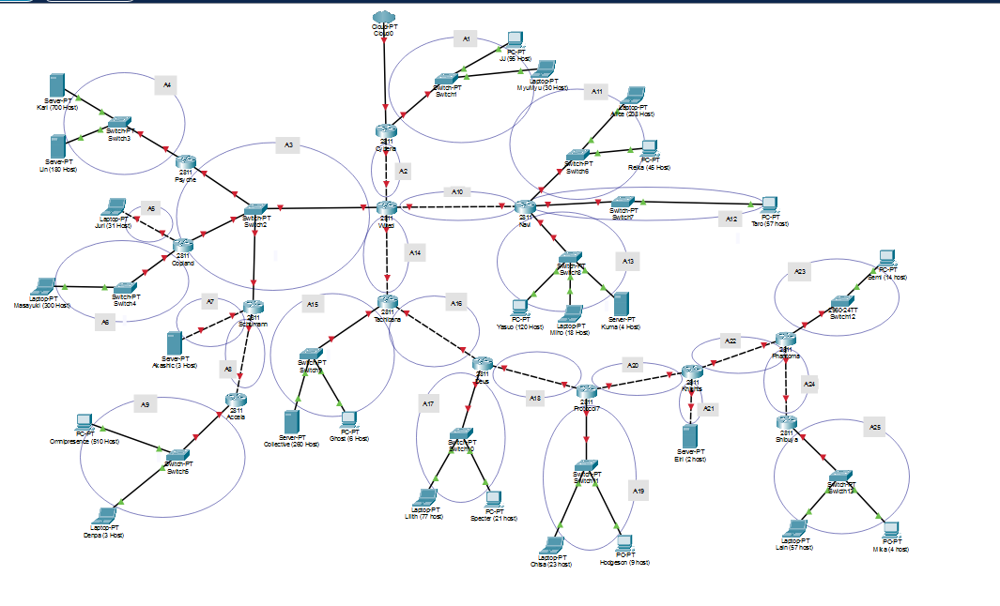
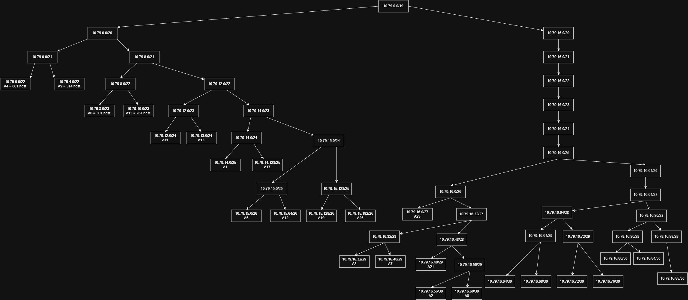

# Praktikum Jarkom Modul 4 K-31 2026

## Angota Kelompok

| Nama | NRP |
| ---- | --- |
| Silfi Rochmatul Auliyah | 5027251008|
| Nabila Sharliz Sigit | 5027241054 |

## Laporan 

[Link SPS] : 
https://docs.google.com/spreadsheets/d/13hz5RoMRi5G96lwfPW-DccZrPvWZEDAc/edit?usp=sharing&ouid=115121444487039308209&rtpof=true&sd=true

CPT - VLSM

1. Topologi
   
   Berikut adalah topologi yang dibangun di Cisco Packet Tracer. Topologi ini terdiri dari 25 subnet (A1 - A25).
   
   

2. Total Penggunaan Subnet
   
   Terdapat 25 subnet dengan total kebutuhan IP sebanyak 2814. Setelah prefix tiap subnet ditentukan, total ukuran bloknya adalah 4188 alamat dengan 4138 IP host yang available. Karena terdapat 4188 alamat yang akan digunakan, blok terkecil yang dapat menampung seluruh subnet adalah 8192, jadi prefix blok induknya adalah /19.

   Kemudian pohon pembagian IP untuk VLSM dapat dilihat pada gambar berikut ini. 

   

   [VLSM Tree yang lebih jelas](assets/VLSM_Tree.png)

3. Static routing 
  
   - **Arah ke atas (menuju Cyberia):** menggunakan satu default route (`0.0.0.0/0`). Semua tujuan yang tidak dikenali router akan diteruskan ke router di atasnya.
   - **Arah ke bawah (menjauhi Cyberia):** menggunakan route sesuai subnet hasil VLSM.

    Tabel Route

    [Cyberia]

    | Network Tujuan | Netmask | Next Hop | Keterangan |
    |---|---|---|---|
    | 10.79.0.0 | 255.255.224.0 | 10.79.16.58 | Seluruh subnet di bawah Wired (/19) |

    [Wired]

    | Network Tujuan | Netmask | Next Hop | Subnet Tujuan |
    |---|---|---|---|
    | 0.0.0.0 | 0.0.0.0 | 10.79.16.57 | Default (Cyberia) |
    | 10.79.0.0 | 255.255.252.0 | 10.79.16.34 | A4 (via Psyche) |
    | 10.79.15.0 | 255.255.255.192 | 10.79.16.35 | A5 (via Copland) |
    | 10.79.8.0 | 255.255.254.0 | 10.79.16.35 | A6 (via Copland) |
    | 10.79.16.40 | 255.255.255.248 | 10.79.16.36 | A7 (via Schumann) |
    | 10.79.16.60 | 255.255.255.252 | 10.79.16.36 | A8 (via Schumann) |
    | 10.79.4.0 | 255.255.252.0 | 10.79.16.36 | A9 (via Schumann) |
    | 10.79.12.0 | 255.255.254.0 | 10.79.16.66 | A11 dan A13 (via Navi) |
    | 10.79.15.64 | 255.255.255.192 | 10.79.16.66 | A12 (via Navi) |
    | 10.79.10.0 | 255.255.254.0 | 10.79.16.70 | A15 (via Tachibana) |
    | 10.79.14.128 | 255.255.255.128 | 10.79.16.70 | A17 (via Tachibana) |
    | 10.79.15.128 | 255.255.255.128 | 10.79.16.70 | A19 dan A25 (via Tachibana) |
    | 10.79.16.0 | 255.255.255.224 | 10.79.16.70 | A23 (via Tachibana) |
    | 10.79.16.48 | 255.255.255.248 | 10.79.16.70 | A21 (via Tachibana) |
    | 10.79.16.72 | 255.255.255.248 | 10.79.16.70 | A16 dan A18 (via Tachibana) |
    | 10.79.16.80 | 255.255.255.240 | 10.79.16.70 | A20, A22, dan A24 (via Tachibana) |

    [Schumann]

    | Network Tujuan | Netmask | Next Hop | Subnet Tujuan |
    |---|---|---|---|
    | 0.0.0.0 | 0.0.0.0 | 10.79.16.33 | Default (Wired) |
    | 10.79.4.0 | 255.255.252.0 | 10.79.16.62 | A9 (via Accela) |

    [Tachibana]

    | Network Tujuan | Netmask | Next Hop | Subnet Tujuan |
    |---|---|---|---|
    | 0.0.0.0 | 0.0.0.0 | 10.79.16.69 | Default (Wired) |
    | 10.79.14.128 | 255.255.255.128 | 10.79.16.74 | A17 (via Deus) |
    | 10.79.15.128 | 255.255.255.128 | 10.79.16.74 | A19 dan A25 (via Deus) |
    | 10.79.16.0 | 255.255.255.224 | 10.79.16.74 | A23 (via Deus) |
    | 10.79.16.48 | 255.255.255.248 | 10.79.16.74 | A21 (via Deus) |
    | 10.79.16.76 | 255.255.255.252 | 10.79.16.74 | A18 (via Deus) |
    | 10.79.16.80 | 255.255.255.240 | 10.79.16.74 | A20, A22, dan A24 (via Deus) |

    [Deus]

    | Network Tujuan | Netmask | Next Hop | Subnet Tujuan |
    |---|---|---|---|
    | 0.0.0.0 | 0.0.0.0 | 10.79.16.73 | Default (Tachibana) |
    | 10.79.15.128 | 255.255.255.128 | 10.79.16.78 | A19 dan A25 (via Protocol7) |
    | 10.79.16.0 | 255.255.255.224 | 10.79.16.78 | A23 (via Protocol7) |
    | 10.79.16.48 | 255.255.255.248 | 10.79.16.78 | A21 (via Protocol7) |
    | 10.79.16.80 | 255.255.255.240 | 10.79.16.78 | A20, A22, dan A24 (via Protocol7) |

    [Protocol7]

    | Network Tujuan | Netmask | Next Hop | Subnet Tujuan |
    |---|---|---|---|
    | 0.0.0.0 | 0.0.0.0 | 10.79.16.77 | Default (Deus) |
    | 10.79.15.192 | 255.255.255.192 | 10.79.16.82 | A25 (via Knights) |
    | 10.79.16.0 | 255.255.255.224 | 10.79.16.82 | A23 (via Knights) |
    | 10.79.16.48 | 255.255.255.248 | 10.79.16.82 | A21 (via Knights) |
    | 10.79.16.80 | 255.255.255.240 | 10.79.16.82 | A22 dan A24 (via Knights) |

    [Knights]

    | Network Tujuan | Netmask | Next Hop | Subnet Tujuan |
    |---|---|---|---|
    | 0.0.0.0 | 0.0.0.0 | 10.79.16.81 | Default (Protocol7) |
    | 10.79.16.0 | 255.255.255.224 | 10.79.16.86 | A23 (via Phantoma) |
    | 10.79.16.88 | 255.255.255.252 | 10.79.16.86 | A24 (via Phantoma) |
    | 10.79.15.192 | 255.255.255.192 | 10.79.16.86 | A25 (via Phantoma) |

    [Phantoma]

    | Network Tujuan | Netmask | Next Hop | Subnet Tujuan |
    |---|---|---|---|
    | 0.0.0.0 | 0.0.0.0 | 10.79.16.85 | Default (Knights) |
    | 10.79.15.192 | 255.255.255.192 | 10.79.16.90 | A25 (via Shibuya) |

    [Psyche, Copland, Accela, Navi, Shibuya]

    | Router | Network Tujuan | Netmask | Next Hop |
    |---|---|---|---|
    | Psyche | 0.0.0.0 | 0.0.0.0 | 10.79.16.33 (Wired) |
    | Copland | 0.0.0.0 | 0.0.0.0 | 10.79.16.33 (Wired) |
    | Accela | 0.0.0.0 | 0.0.0.0 | 10.79.16.61 (Schumann) |
    | Navi | 0.0.0.0 | 0.0.0.0 | 10.79.16.65 (Wired) |
    | Shibuya | 0.0.0.0 | 0.0.0.0 | 10.79.16.89 (Phantoma) |

4. Konfigurasi Static IP 
   
   Konfigurasi static ip dilakukan pada setiap router ataupun host sesuai dengan range ip yang telah didapatkan pada spreadsheet pembagian ip vlsm. 